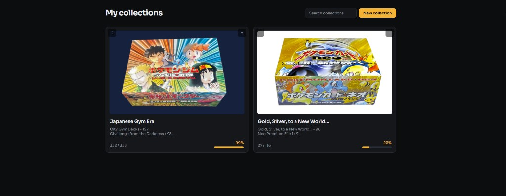

# PokeCardTracker

Track custom Pokémon TCG collections. Build a set, mark what you own, and flip through it like a binder.




## Features

- Dashboard of collections with covers, search, and progress
- Grid or 3×3 binder, with All / Owned / Missing and set filters
- Owned state is per card, shared across collections
- Add cards from a Japanese set ([The TCG OS](https://www.thetcgos.com/g/pokemon/japanese) or JSON), an English [TCGdex](https://tcgdex.dev/) search, or a manual entry with a photo

## Local development

1. Copy `.env.example` to `.env.local` and set `VITE_SUPABASE_URL` and `VITE_SUPABASE_ANON_KEY`.

2. Install and run:

```bash
npm install
npm run dev
```

Open [http://localhost:5173](http://localhost:5173). By default, local dev uses the same magic link as production (`/login`). Optional: set `VITE_DEV_GUEST=true` in `.env.local` to auto sign-in as an anonymous guest. Magic-link redirects are in [DEPLOYMENT.md](./DEPLOYMENT.md).

## Scripts

- `npm run dev` — Vite on port 5173
- `npm run build` / `npm run preview`
- `npm run typecheck`
- `npm run lint`

## Docs

- [docs/card-sources-research.md](./docs/card-sources-research.md)
- [docs/database-schema.md](./docs/database-schema.md)
- [DEPLOYMENT.md](./DEPLOYMENT.md)
