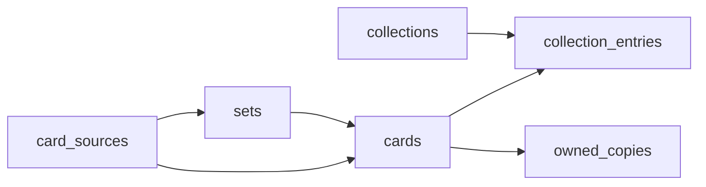

# Database schema

Postgres via Supabase. RLS scopes all user data to `auth.uid()`.

## Entity diagram

## Tables

### `card_sources`

One row per provider (`pokemontcg`, `tcgdex`, `manual`). New sources plug in via `CardSourceAdapter` without schema changes.

### `sets`

Optional grouping: `source_id`, `external_id`, `name`, `series`, `language`, `release_date`, `image_path`, `raw`.

### `cards`

One row per exact printing. `external_id` null for manual cards. `category` enum: official, promo, variant, misprint, custom. `attrs` jsonb for provider extras. FTS + trigram on name/number.

### `collections`

User-owned lists: name, description, `cover_image_path`, `goal_count`, `sort_order`.

### `collection_entries`

Links collection ↔ card with `position` (binder order), optional `slot_label` and `notes`. Same card may appear in multiple collections.

### `owned_copies`

Physical inventory **per copy group** (multiple rows per card allowed). Fields: condition, language, edition, variant, quantity, purchase_price, notes. Ownership is global per user—owned status reflects in every collection containing that card.

Unique group key: `(user_id, card_id, condition, edition, variant, language)` with nulls normalized in the index.

## Views / RPC

- `collection_progress_summary` — entry totals, owned entry count, percent, goal metadata.
- `collection_progress` — alias subset for reporting.
- `collection_progress_breakdown(collection_id)` — JSON by rarity, set, category.

Owned counts use **sum of quantities** across copy groups per card (no double-counting when multiple groups exist).

## Storage

- `collection-covers` — dashboard cover images (public read, user-scoped write).
- `card-images` — manual uploads and cached API art (public read, user-scoped write).
