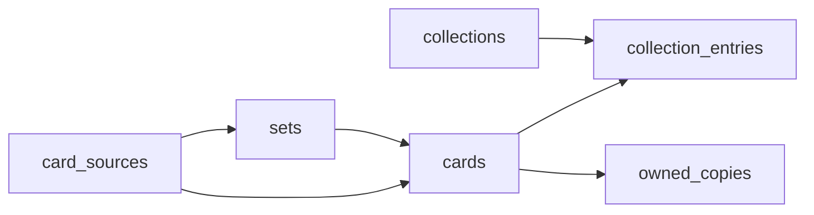

# Database schema

Postgres via Supabase. RLS scopes all user data to `auth.uid()`.

## Entity diagram

## Tables

### `card_sources`

One row per provider (`tcgdex`, `manual`).

### `sets`

Optional grouping: `source_id`, `external_id`, `name`, `series`, `language`, `release_date`, `image_path`, `raw`.

### `cards`

Catalog or manual cards: `source_id`, `external_id`, `set_id`, `name`, `language`, `image_path`, `image_url`, `attrs`. Full-text search on `name`.

### `collections`

User lists: `name`, `description`, `cover_image_path`, `sort_order`.

### `collection_entries`

Links collection ↔ card with `position` (display order). Same card may appear in multiple collections.

### `owned_copies`

One row per user per card when marked owned (`user_id`, `card_id`, `language`). Ownership is global—reflected in every collection containing that card.

## Views

- `collection_progress_summary` — entry totals, owned entry count, percent.
- `collection_progress` — alias with a subset of columns.

## Storage

- `collection-covers` — dashboard cover images (public read, user-scoped write).
- `card-images` — cached or uploaded card art (public read, user-scoped write).
