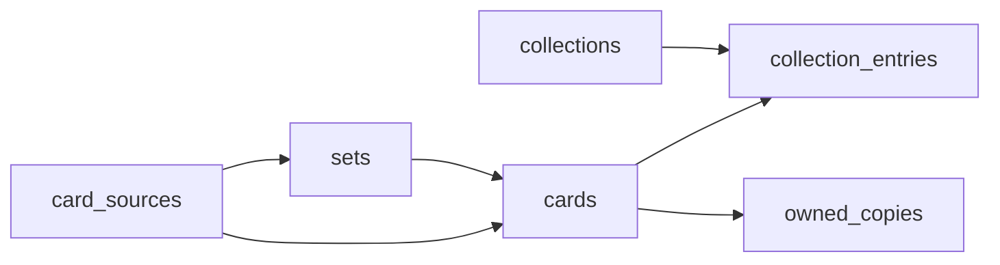

# Database schema

Postgres on the hosted Supabase project **PokeCardTracker**. There is no `supabase/migrations` directory in the repo; the schema already lives on that project. `supabase/seed.sql` only inserts `card_sources` rows (`tcgdex`, `manual`).

Catalog tables (`card_sources`, `sets`, `cards`) are shared: any signed-in user can read them, and insert/update policies on `sets` and `cards` are open. User-owned rows are scoped to `auth.uid()`: `collections`, `collection_entries`, `owned_copies`, and storage object paths.

## Entity diagram

## Tables

### `card_sources`

Provider registry. The app uses `tcgdex` (`https://api.tcgdex.net/v2`, search and set read) and `manual` (no base URL). A `pokemontcg` row may still be present from an older version; nothing in the app selects it.

Columns: `id`, `name`, `base_url`, `supports_search`, `supports_set_import`, `created_at`.

### `sets`

Optional grouping. Unique on `(source_id, external_id)`.

`source_id`, `external_id`, `name`, `series`, `language`, `release_date`, `image_path`, `raw`, `created_at`.

Manual and The TCG OS imports reuse an existing set when the name matches (preferring a `tcgdex` row). Japanese imports store `language = jp`.

### `cards`

Catalog or manual cards. Unique on `(source_id, external_id)`. Several manual rows may share a null `external_id` (hand entry and JSON import). The TCG OS import sets `external_id` to `tcgplayer-{productId}`, so the same product updates in place.

| Column | Notes |
|--------|--------|
| `source_id` | `tcgdex` or `manual`. |
| `external_id` | TCGdex id, `tcgplayer-{productId}`, or null. |
| `set_id` | Nullable FK to `sets`. |
| `name`, `language` | App language code is `jp` or `en` (not TCGdex’s `ja`). |
| `image_path` | Object key in `card-images`, when cached or uploaded. |
| `image_url` | Remote URL when the file is not in Storage (TCGplayer CDN, or TCGdex before cache). |
| `attrs` | TCGdex payload on catalog add. JSON import may set `en_external_id` and `en_resolve_error`. |
| `created_by` | User id for manual, JSON, and The TCG OS inserts. |
| `search_vector` | Generated from `name`. GIN index plus a trigram index on `name`. Collection search filters in the client; it does not query this column. |

### `collections`

User lists: `user_id`, `name`, `description`, `cover_image_path`, `sort_order`, `binder_gaps`, `created_at`, `updated_at`.

`binder_gaps` is an `integer[]` of empty binder slots (0-based positions). Default `'{}'`.

### `collection_entries`

One card in one collection. Unique on `(collection_id, card_id)`. `position` is display order. The same card may appear in more than one collection.

### `owned_copies`

One row per user per card (`unique (user_id, card_id)`). Presence means owned. `language` is stored with the row (default `jp` when marking owned). Ownership is global: every collection that contains the card shows it as owned. There is no quantity, condition, price, or notes column.

## Views

- `collection_progress_summary` — collection fields (including `binder_gaps`), `total_entries`, `owned_entries`, `owned_percent`. Owned means an `owned_copies` row for that collection’s user and card. The dashboard reads this view.
- `collection_progress` — same totals without description, cover, sort, or `binder_gaps`.

## Storage

Public read. Writes only under the first path segment equal to `auth.uid()`.

| Bucket | Paths the app writes |
|--------|----------------------|
| `collection-covers` | `{userId}/{collectionId}-{fileName}` |
| `card-images` | `{userId}/cached/{cardId}.webp` (TCGdex), `{userId}/manual/{cardId}.{ext}` (upload) |

The TCG OS import keeps the TCGplayer CDN URL in `cards.image_url` and does not upload a file.

Display prefers `image_path` (public Storage URL), then `image_url`.
